# 一级标题

## 二级标题

### 三级标题

#### 四级标题

##### 五级标题

###### 六级标题

Setext 一级标题
===============

Setext 二级标题
---------------

---

## 行内样式

**粗体**、*斜体*、***粗斜体***、~~删除线~~、`行内代码`、<kbd>Ctrl</kbd> + <kbd>S</kbd>

转义字符：\*不是斜体\*、\`不是代码\`、\\反斜杠、\_下划线\_

HTML 实体：&copy; &amp; &lt; &gt; &nbsp; &mdash;

行内链接：[示例链接](https://example.com "链接标题")、[引用式链接][ref-1]、自动链接 <https://example.com>、裸链接 https://example.com

图片： 与 

## 列表

无序列表：

- 第一项
- 第二项
  - 嵌套项
    - 更深一层
- 第三项

有序列表：

1. 第一步
2. 第二步
   1. 子步骤一
   2. 子步骤二
3. 第三步

任务列表：

- [x] 已完成的任务
- [ ] 未完成的任务

混合嵌套：

1. 有序项
   - 其中嵌套无序项
     > 引用嵌在列表里

## 引用

> 一级引用
>
> > 二级引用
> >
> > > 三级引用

> 引用里的代码：
>
> ```js
> console.log('quoted')
> ```

## 代码

行内代码 `const answer = 42` 结束。

```rust
fn main() {
    println!("你好，MarkdownProMax");
}
```

```javascript
const sum = (a, b) => a + b
console.log(sum(1, 2))
```

```python
def greet(name: str) -> str:
    return f"Hello, {name}"
```

```json
{ "name": "markdownpromax", "version": "0.1.0" }
```

```bash
pnpm install && pnpm tauri dev
```

```diff
- 旧内容
+ 新内容
```

缩进代码块：

    indented code block
    second line here

## 表格

| 左对齐 | 居中 | 右对齐 |
| :----- | :--: | -----: |
| 苹果   |  3   | ¥12.50 |
| 香蕉   |  12  |  ¥3.20 |
| `代码` | **粗体** | [链接](https://example.com) |

## 分割线

---

***

___

## 脚注

带脚注的句子[^1]，以及第二个脚注[^note]。

[^1]: 第一个脚注的内容。
[^note]: 第二个脚注，支持 **Markdown** 与 `代码`。

## 数学公式

行内公式：$E = mc^2$，以及 $\int_0^1 x^2\,\mathrm{d}x = \frac{1}{3}$。

块级公式：

$$
\begin{aligned}
\nabla \cdot \mathbf{E} &= \frac{\rho}{\varepsilon_0} \\
\nabla \cdot \mathbf{B} &= 0
\end{aligned}
$$

## Mermaid 图表

### 流程图

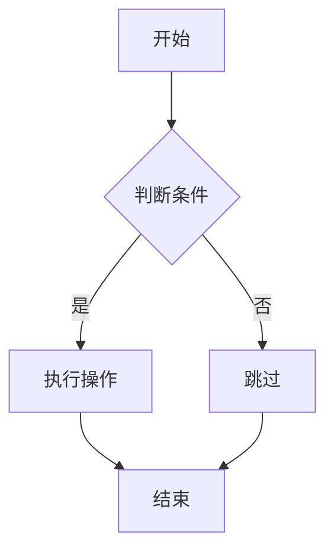

### 时序图

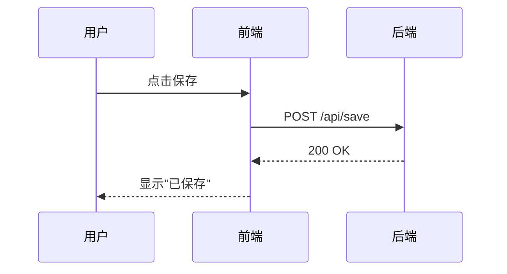

### 类图

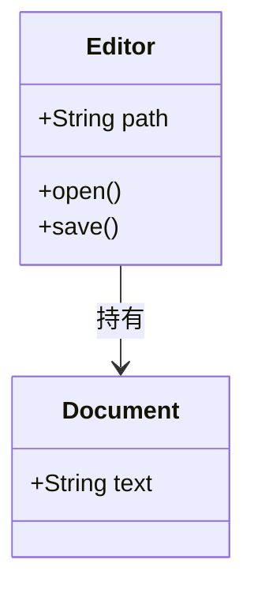

### 状态图

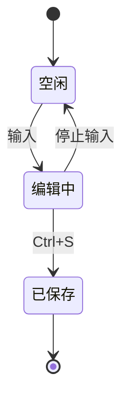

### ER 图

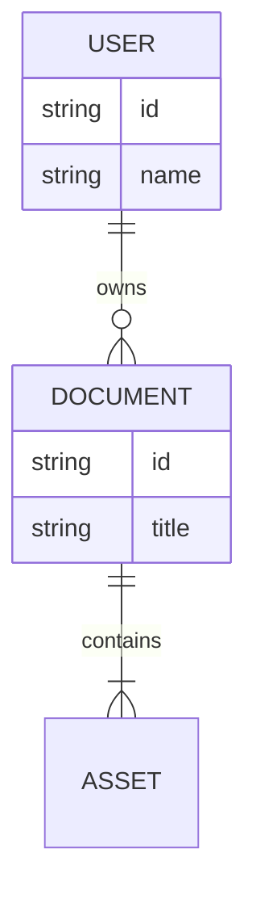

### 甘特图

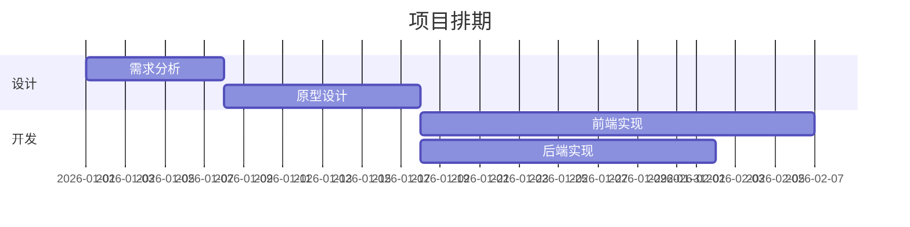

### 饼图

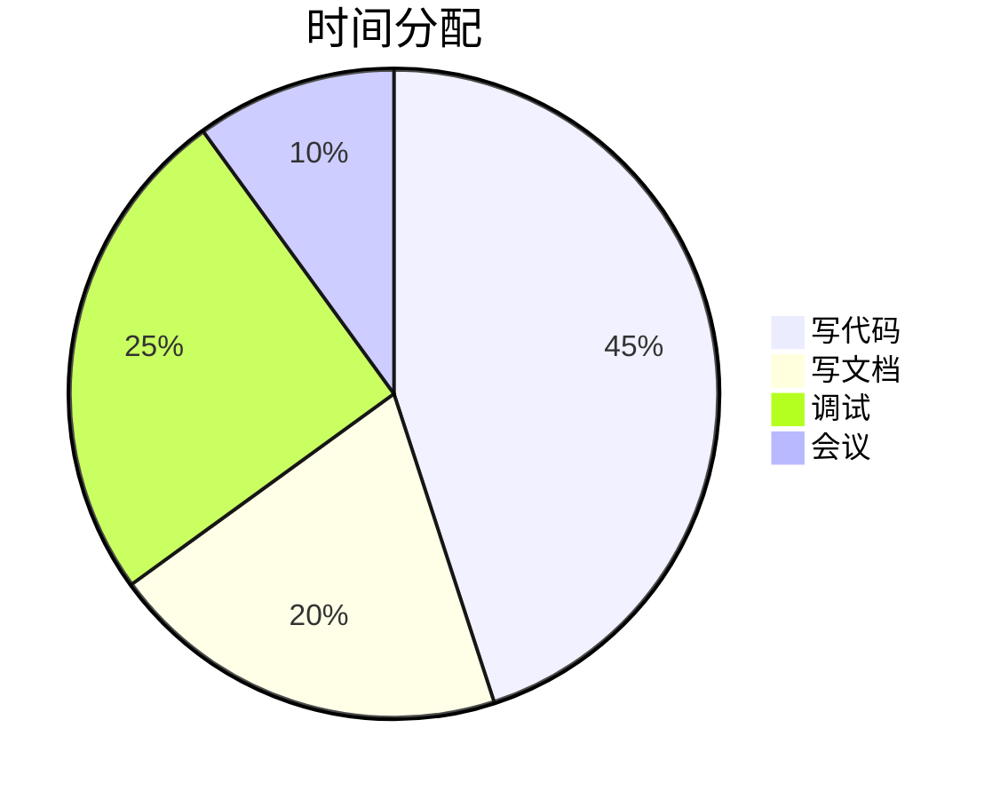

### 用户旅程

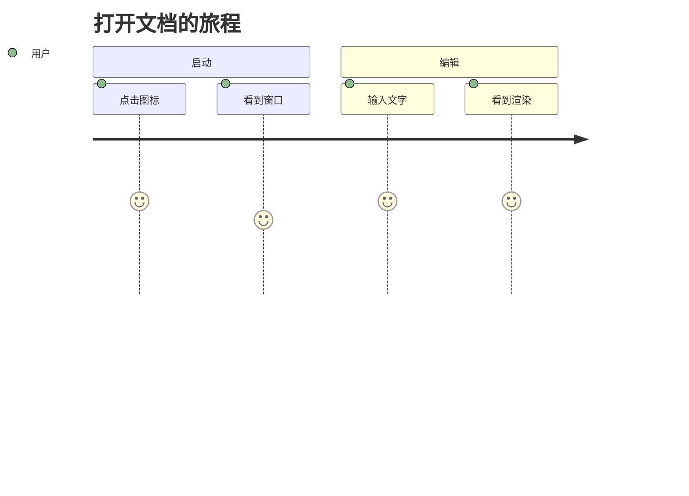

### Git 图

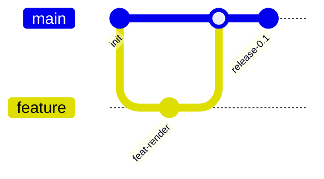

### 思维导图

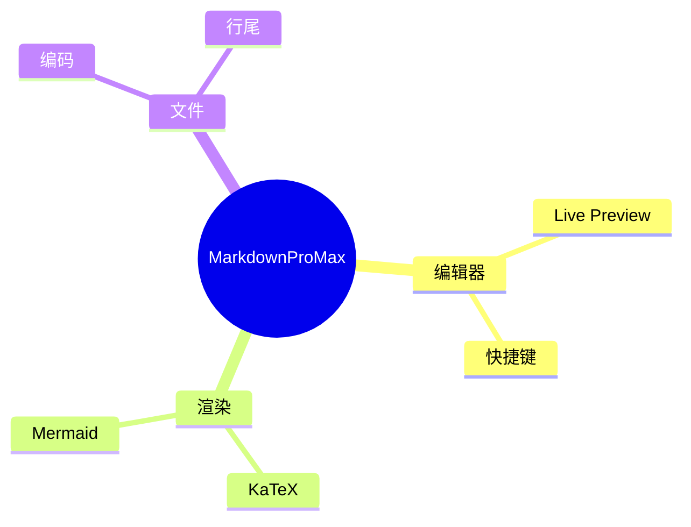

### 时间线

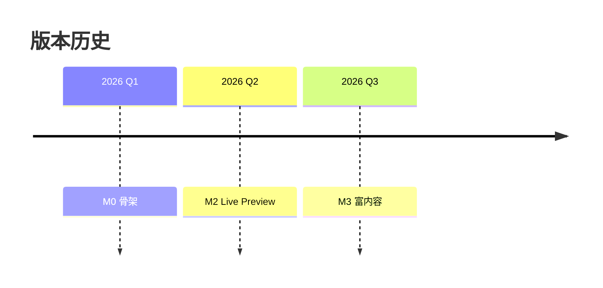

### 象限图

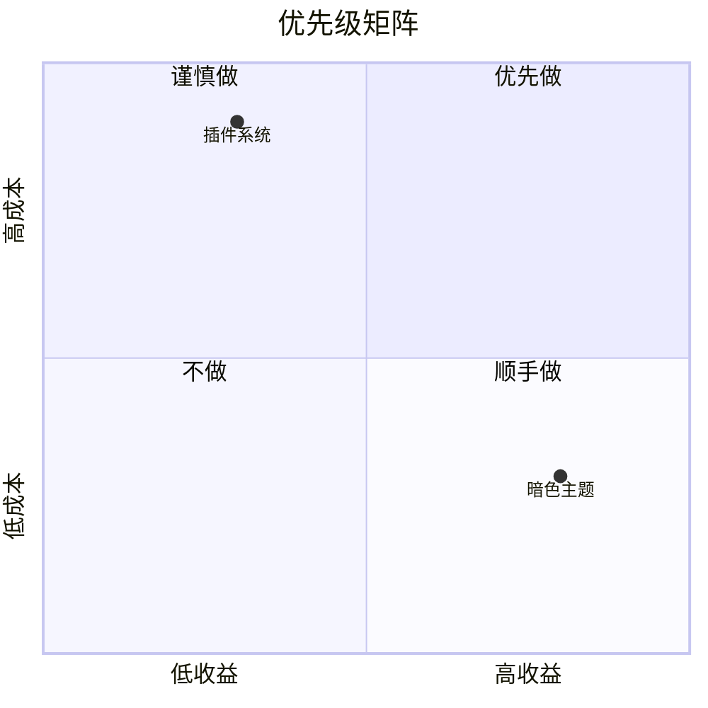

### XY 图

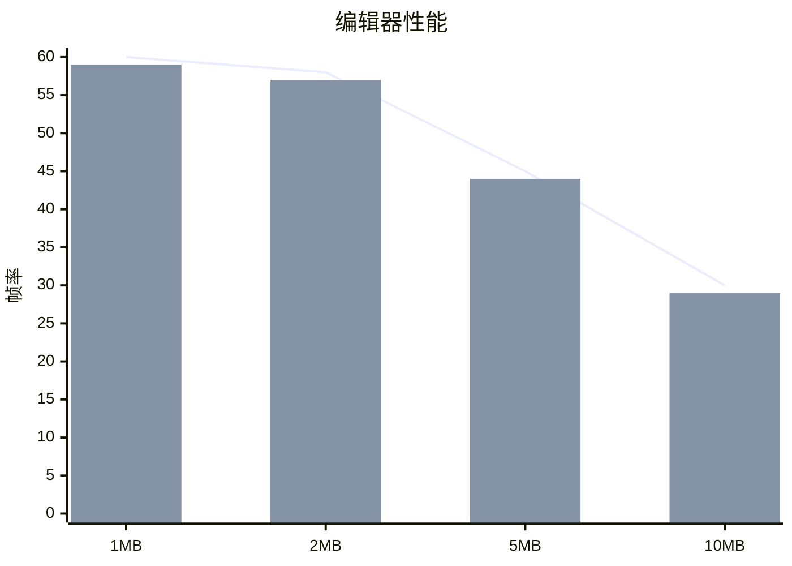

### 需求图

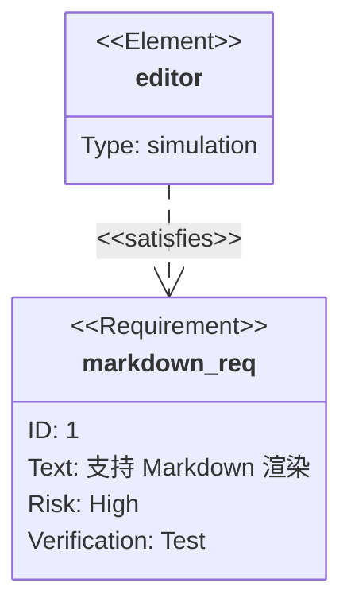

### 桑基图

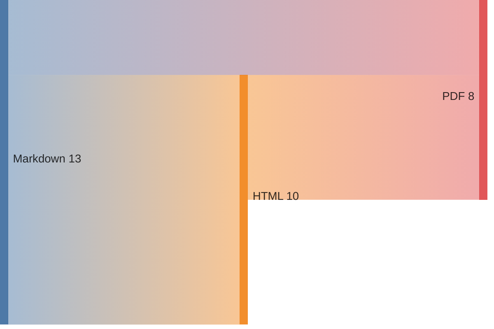

## HTML

<div align="center">
  <strong>HTML 块级内容</strong>
</div>

行内 HTML：<span style="color: #e11d48">红色文字</span>

## 换行

两个空格结尾换行  
这一行是第二行

反斜杠换行\
这一行也是第二行

## 引用式链接定义

[ref-1]: https://example.com/ref "引用标题"

## 结束

文档到这里结束。
